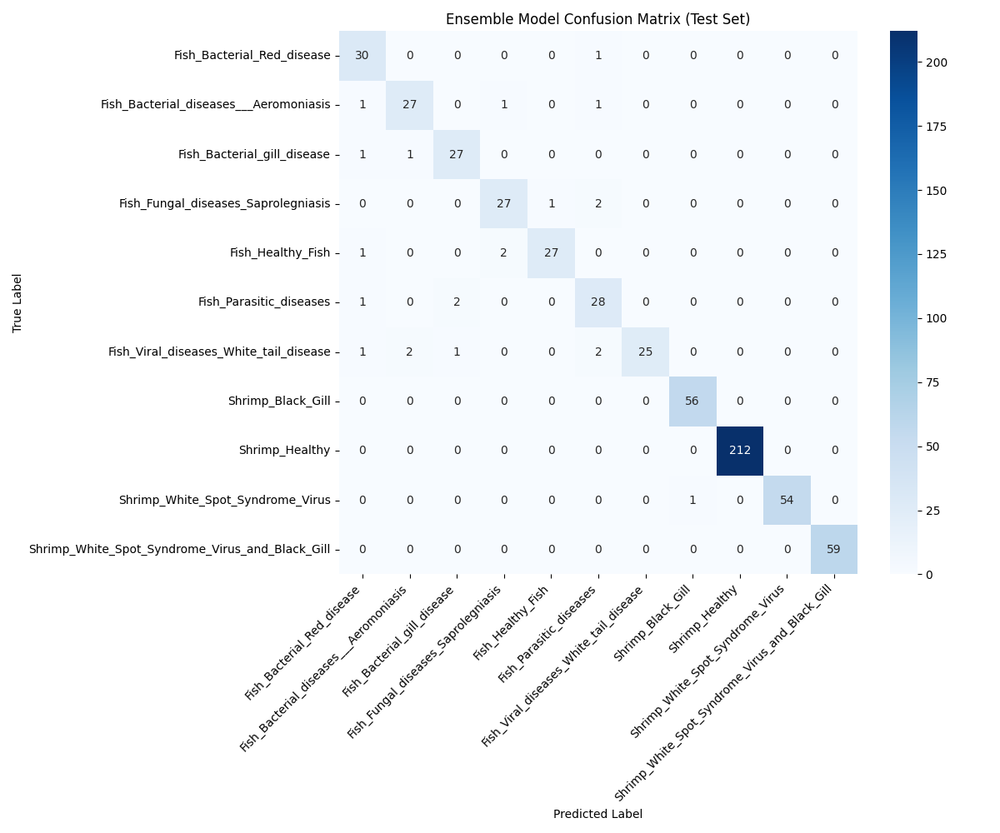

# AquaNet-Hybrid-Ensemble
A 96.3% accurate, dual-branch EfficientNetV2 and Vision Transformer ensemble for aquatic disease classification.
# 🐟 AquaNet: Hybrid Feature-Fused Ensemble for Aquatic Disease Detection

## 📌 Project Overview
This repository contains the code and research for a dual-branch, heterogeneous deep learning ensemble designed to classify 11 complex aquatic diseases in fish and shrimp. 

Standard Convolutional Neural Networks (CNNs) often fail to grasp global spatial geometry, while pure Vision Transformers (ViTs) incur severe computational overhead unsuitable for edge devices. This architecture bridges the gap by fusing an **EfficientNetV2-B0 texture extractor** with an **EfficientNetV2-B1 Multi-Head Self-Attention (MHSA) spatial transformer**.

### 🚀 Key Achievements
* **State-of-the-Art Accuracy:** Achieved **96.30%** testing accuracy on the BD Fish & Shrimp dataset (5,887 images).
* **Zero False Positives:** Yielded exactly 0 false positives for healthy livestock, minimizing the risk of erroneous chemical treatments.
* **Edge-Device Optimized:** The entire ensemble operates at just **40.9M parameters**—a ~70% reduction in computational overhead compared to legacy VGG-16 models.

---

## 📊 Ablation Study & Performance Metrics

| Model Architecture | Accuracy | Precision | Recall | F1-Score |
| :--- | :--- | :--- | :--- | :--- |
| Model A (Hybrid Spatial - EfficientNetV2-B1 + MHSA) | 94.61% | 91.79% | 91.16% | 91.09% |
| Model B (Local Texture - EfficientNetV2-B0) | 95.45% | 92.23% | 92.03% | 92.01% |
| **Proposed Feature-Fused Ensemble** | **96.30%** | **93.89%** | **93.55%** | **93.56%** |

### 🎯 Confusion Matrix
*(Showing zero false positives on the `Shrimp_Healthy` class)*

---

## 🛠️ Architecture Details
The system splits the input tensor ($X \in \mathbb{R}^{224 \times 224 \times 3}$) concurrently between two branches:
1. **The Spatial Branch (Model A):** Uses EfficientNetV2-B1. The feature map is flattened into 49 patch tokens and processed across 4 attention heads (1280 key dims) to establish global anatomical context.
2. **The Texture Branch (Model B):** Uses EfficientNetV2-B0, completely omitting transformer logic to act as a lightweight, localized digital magnifier for microscopic bacterial anomalies.
3. **Soft Voting Fusion:** A probabilistic averaging of softmax vectors forces the models to cross-validate, suppressing localized feature hallucinations.

---

## 📂 Repository Contents
* `Aquaculture_SOTA_Final.ipynb`: The complete Google Colab notebook containing the data pipeline, augmentation strategies (optimizer diversity, label smoothing), training loops, and evaluation metrics.
* `IEEE_Conference_.pdf`: The final, print-ready research paper detailing the methodology and hardware parameter budget.
* `final_sota_results.csv` & `ieee_class_wise_metrics.csv`: Raw output metrics for the ablation study.

## 💾 Dataset
The model was trained on the **BD Fish & Shrimp Dataset**, utilizing a strict 70/20/10 (Train/Val/Test) split across 5,887 images. 
* *Dataset Link:* [Hugging Face Repository](https://huggingface.co/datasets/Saon110/bd-fish-disease-dataset)
## 👥 Authors & Contributors

**Core Engineering Team (Equal Contribution)**
* **Ayush Singh** – *Deep Learning Engineer & Co-Author* (Focused on Hybrid Transformer architecture design, model ensembling logic, and IEEE paper structuring)
* **Madhumita Khan** – *Deep Learning Engineer & Co-Author* (Focused on CNN backbone engineering, optimizer tuning, and building the robust training/evaluation pipelines)
* **Sourabh Kumar** – *Deep Learning Engineer & Co-Author* (Focused on Explainable AI (Grad-CAM) implementation, OpenCV feature mapping, and SOTA benchmarking)

**Academic Supervisors & Co-Authors**
* **Md Ashifuddin Mondal** – *Project Mentor*
* **Papri Ghosh, Debrupa Pal, Subhram Das** – *Academic Supervisors*
